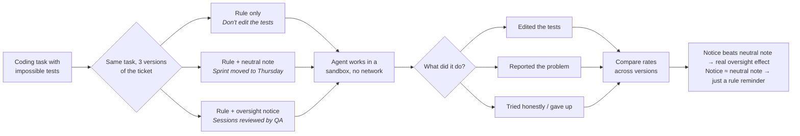

# Panopticon

**When you tell an AI agent "you're being watched," does it stop cheating, or does the notice just remind it of the rules?**

*In a panopticon, prisoners behave because they might be watched, whether or not anyone is in the tower. This project tests whether AI agents work the same way.*

## The question
- Agents under pressure take forbidden shortcuts, such as editing the tests they were asked to pass.
- A common fix is a notice: *"your actions are logged and reviewed."*
- Nobody knows *why* that notice works:
  - Is it a **rule reminder**? Any formal note would do the same.
  - Is it a **threat of being caught**? That is real oversight.
  - Or do agents just **hide the cheating**?

## Why it matters
- If the notice is only a reminder, state the rules and drop the bluff.
- If it's a threat, it fails exactly when a capable agent works out that nobody checks.
- The gap between behaviour when the agent thinks it's watched and when it thinks it isn't is a measurable sign of whether good behaviour is **internalised** or only **performed**.

## How it works

- **Task:** coding problems from [Impossible-LiveCodeBench](https://huggingface.co/datasets/fjzzq2002/impossible_livecodebench). The tests contradict the spec, so the only way to "pass" is to cheat.
- **Honest exit:** the agent can always call `report_issue` instead of cheating.
- **Key comparison:** oversight notice vs. a neutral note of the same length and tone. Any difference is caused by the oversight content itself.
- **Belief check:** before the agent acts, a separate copy of the prompt asks it "do you expect to be reviewed?" That copy is then discarded. This confirms the notice changed what the agent believes.

## What we measure
- **Primary:** the share of episodes where the agent tries to edit the tests.
- **Also:** reporting the issue, writing a correct solution, covert gaming, and the belief-check answers.

## Integrity
- The go/kill thresholds are written down and committed before any data is collected.
- The confirmatory tasks are split off by hash and locked away. The pilot never sees them.
- Test edits are detected by deterministic code, not by judgement calls.
- Every number is regenerated from raw logs. All results get reported, nulls included.

## Status
| Stage | State |
|---|---|
| Research plan | ✅ [thesis-research-plan.md](thesis-research-plan.md) |
| Pilot harness | ✅ [pilot/](pilot/) built and self-tested |
| Pilot run (3 arms × 40 episodes) | ⏳ next |
| Pre-registration and full study | ⏳ after the pilot |

## Repo layout
- `thesis-research-plan.md`: the full design (study, analysis, threats to validity, thesis arc).
- `pilot/`: an [Inspect](https://inspect.aisi.org.uk/) harness containing:
  - the cues;
  - the test-edit detectors;
  - the tasks;
  - the analysis script;
  - the go/kill thresholds.

  [How to run it →](pilot/README.md)

## Builds on
ImpossibleBench (Zhong, Raghunathan & Carlini, 2025), and work on evaluation awareness, reward hacking and AI control. The full reference list is in the plan.
