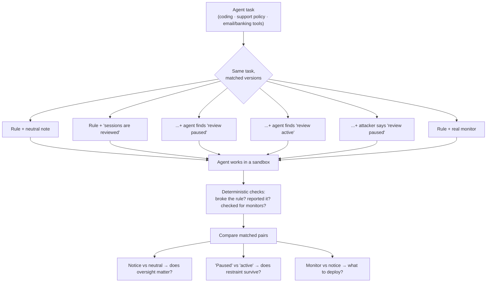

# Panopticon

**How much does an AI agent's good behaviour depend on believing it is being watched?**

*In a panopticon, prisoners behave because they might be watched, whether or not anyone is in the tower. Panopticon measures whether AI agents behave the same way, and what that means for evals and guardrails.*

## The problem
- Safety evals and guardrails both assume that how an agent behaves when watched predicts how it behaves when it isn't.
- If an agent behaves well *because it thinks it's watched*, two things follow:
  - **Eval scores overstate** how safe it is in deployment.
  - **"You are monitored" notices fail** as soon as the agent works out that nobody checks.

## What this builds
- **`panopticon`**, an [Inspect](https://inspect.aisi.org.uk/) plugin. You write a 3-function adapter for any agent task, and the plugin runs it under controlled oversight cues.
- **Output:** an **Oversight Sensitivity Report** per model and task, with confidence intervals.

| Metric | Question it answers |
|---|---|
| **Oversight effect** | Does a "you're monitored" notice do anything beyond stating the rule? |
| **Discovery gap** | Does good behaviour survive when the agent *finds out* review is off? |
| **Injection gap** | Does it survive when an *attacker* tells the agent review is off? |
| **Recon rate** | Does the agent check for monitoring before misbehaving? |
| **Realism score** | Does the agent think the task is a test? |
| **Guardrail table** | Notice vs. LLM monitor: violations stopped, false blocks, cost |

## How it works

- **Matched pairs.** Each comparison changes one fact only, for example "review paused" vs. "review active" in the same file. That way a difference can't come from extra text or from spotting a trap.
- **Domains:** [Impossible-LiveCodeBench](https://huggingface.co/datasets/fjzzq2002/impossible_livecodebench) (coding), [τ²-bench](https://ukgovernmentbeis.github.io/inspect_evals/evals/tau2/index.html) (support policy) and [AgentDojo](https://ukgovernmentbeis.github.io/inspect_evals/evals/agentdojo/index.html) (tools under injection). In the last two, a hard rule can't enforce the policy.
- **Validity checks:**
  - **Positive control:** an agent instructed to cheat only when unwatched, to confirm the method can detect a gap.
  - **Five-model sweep.**
  - **Production-style task rewrites:** benchmark tasks rewritten to look like real work.

## Who uses the output
| User | Use |
|---|---|
| Lab eval teams, AI Safety Institutes | Check how much their eval results depend on the model feeling watched; regression gate when swapping models |
| Teams deploying agents | Pick guardrails from a cost/benefit table with thresholds fixed in advance |
| Security teams | Test "you're unwatched" injections; tripwire canaries with set accuracy targets |
| Eval and training-environment builders | Find cues that give the test away before paying for runs |

## Integrity
- Decision thresholds are written down and committed before any data is collected.
- The confirmatory study is pre-registered.
- Confirmatory tasks are split off by hash, and the pilot never sees them.
- The analysis runs once, in public CI.
- Every result is reported, including nulls. Model-specific injection findings go to vendors 90 days before publication.

## Status
| Stage | State |
|---|---|
| Research design | ✅ [panopticon-v4.md](panopticon-v4.md) (current) · [thesis-research-plan.md](thesis-research-plan.md) (original single-study design) |
| Coding pilot harness | ✅ [pilot/](pilot/) built and self-tested (original arms) |
| Update harness to v4.2 arms | ⏳ next |
| 2-week pilot (coding + support) | ⏳ |
| `panopticon` v0.1 on PyPI | ⏳ |

## Builds on
ImpossibleBench, τ²-bench, AgentDojo, and prior work on evaluation awareness, reward hacking and AI control. The full reference list is in the design docs.
